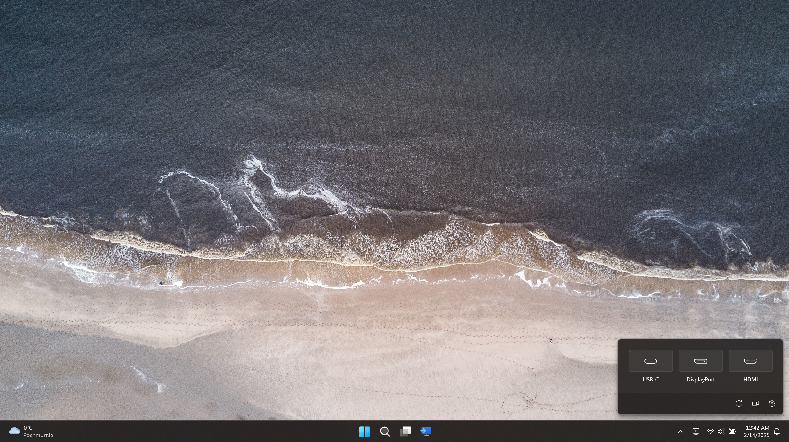

# Input Switcher

Input Switcher is a handy application that allows you to switch your signal source, such as USB-C, DisplayPort, and HDMI, with just a single click. It's incredibly useful for those who have two computers connected to one monitor or use two docking stations.

ℹ️ Make sure your monitors support DDC/CI features (such as changing contrast, volume or power state).

  

  

Feel free to share ideas about new features or report bugs.